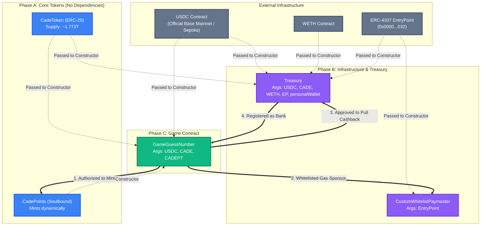

# Smart Contract Dependencies & Independent Deployment Guide

This document maps out the dependency graph, permission wiring, and step-by-step procedures for deploying contracts either as a full suite or individually (e.g. redeploying only the Game contract without redeploying tokens).

---

## 1. Contract Dependency & Permission Architecture

The diagram below illustrates the constructor dependencies (who needs what address at deployment) and post-deployment permission wiring.



---

## 2. Order of Deployment (From Scratch)

When deploying to a new network from zero:

### Phase A: Independent Tokens
These contracts require no constructor arguments.
1. Deploy **`CadeToken.sol`**
2. Deploy **`CadePoints.sol`**

### Phase B: Infrastructure & Treasury
Requires addresses from Phase A and network infrastructure.
3. Deploy **`CustomWhitelistPaymaster.sol`** (Args: `EntryPoint`)
4. Deploy **`Treasury.sol`** (Args: `USDC`, `CadeToken`, `WETH`, `EntryPoint`, `personalWallet`)
5. Fund Treasury with **1,000,000,000,000 CADE (1 Trillion CADE)**.

### Phase C: Game Contract
Requires tokens from Phase A.
6. Deploy **`GameGuessNumber.sol`** (Args: `USDC`, `CadeToken`, `CadePoints`)

### Phase D: Permission Wiring (Mandatory Post-Deploy)
Connect contracts together:
```bash
# 1. Authorize Game to mint CadePoints for round prizes
cast send <CADE_POINTS> "addGameContract(address)" <GAME_ADDRESS>

# 2. Whitelist Game so Paymaster sponsors gas fees
cast send <PAYMASTER> "addWhitelistedContract(address)" <GAME_ADDRESS>

# 3. Allow Game to pull CADE cashback for players from Treasury
cast send <TREASURY> "approveGame(address)" <GAME_ADDRESS>

# 4. Set Treasury as the bank that receives USDC and dispenses cashback
cast send <GAME_ADDRESS> "setBankAccountAddress(address)" <TREASURY>
```

---

## 3. How to Redeploy ONLY `GameGuessNumber` (Without Re-deploying Everything)

When you make a change to `GameGuessNumber.sol` (e.g. adding `transferOwnership`, fixing game logic), **DO NOT rerun the full deploy script**. Follow this isolated procedure:

### Step 1: Deploy Only `GameGuessNumber.sol`
Run `forge create` targeting only the game contract using existing token addresses:
```bash
# Set your environment addresses
USDC_ADDR="0x..."       # Official USDC address on Base
CADE_ADDR="0x..."       # Existing CadeToken address
CADEPT_ADDR="0x..."     # Existing CadePoints address
TREASURY_ADDR="0x..."   # Existing Treasury address
PAYMASTER_ADDR="0x..."  # Existing Paymaster address

# Deploy
forge create src/GameGuessNumber.sol:GameGuessNumber \
  --rpc-url <RPC_URL> \
  --private-key <PRIVATE_KEY> \
  --broadcast \
  --constructor-args $USDC_ADDR $CADE_ADDR $CADEPT_ADDR
```
*(Copy the newly deployed `Deployed to: 0x...` address into `NEW_GAME_ADDR`)*

### Step 2: Wire the 4 Permissions
Execute the 4 connections for the new game:
```bash
# 1. Authorize new game on CadePoints
cast send $CADEPT_ADDR "addGameContract(address)" $NEW_GAME_ADDR --rpc-url <RPC> --private-key <KEY>

# 2. Whitelist new game on Paymaster
cast send $PAYMASTER_ADDR "addWhitelistedContract(address)" $NEW_GAME_ADDR --rpc-url <RPC> --private-key <KEY>

# 3. Approve new game on Treasury
cast send $TREASURY_ADDR "approveGame(address)" $NEW_GAME_ADDR --rpc-url <RPC> --private-key <KEY>

# 4. Point new game's bank to Treasury
cast send $NEW_GAME_ADDR "setBankAccountAddress(address)" $TREASURY_ADDR --rpc-url <RPC> --private-key <KEY>
```

### Step 3: (Optional) Revoke the Old Game
To keep the ecosystem clean:
```bash
cast send $TREASURY_ADDR "revokeGame(address)" $OLD_GAME_ADDR --rpc-url <RPC> --private-key <KEY>
cast send $PAYMASTER_ADDR "removeWhitelistedContract(address)" $OLD_GAME_ADDR --rpc-url <RPC> --private-key <KEY>
```

### Step 4: Update Frontend
1. Update `VITE_GAME_GUESS_NUMBER_ADDRESS_...` in `frontend/.env` with `$NEW_GAME_ADDR`.
2. Copy ABI:
   ```bash
   cp contracts/out/GameGuessNumber.sol/GameGuessNumber.json frontend/src/GameGuessNumberABI.json
   ```
3. Restart frontend dev server or rebuild.
